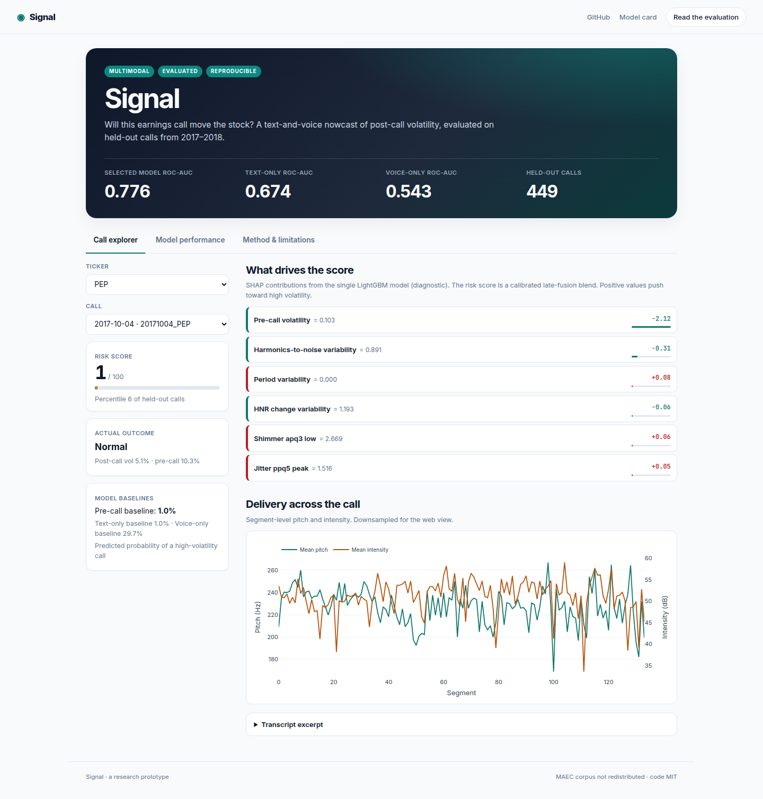
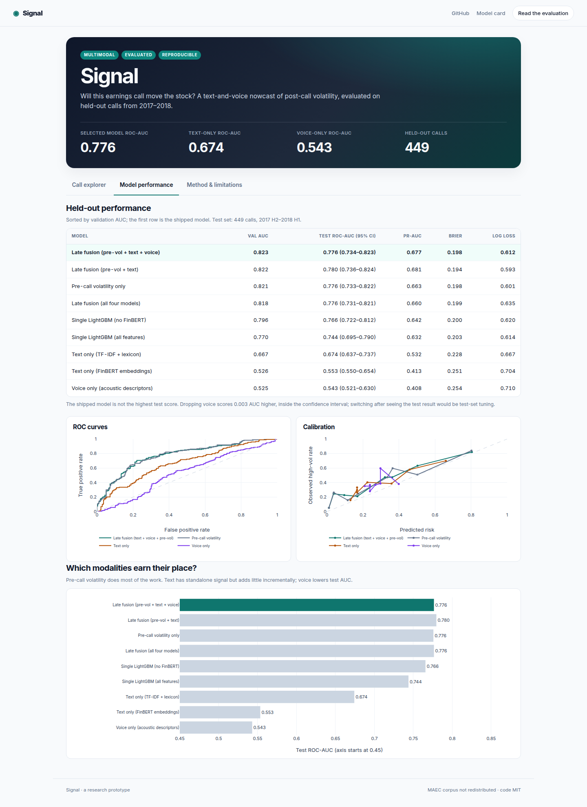
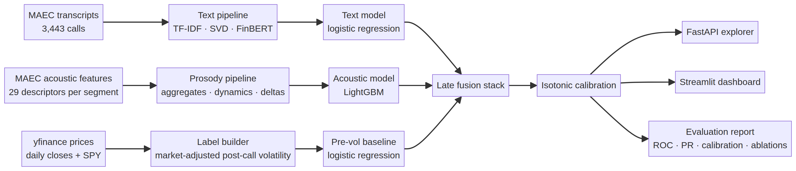

# Signal

**Will this earnings call move the stock? A multimodal nowcast of post-call volatility, with an ablation that reports what actually works.**


**Live dashboard:** [imsheheryar.github.io/signal](https://imsheheryar.github.io/signal/) — a static mirror of the same held-out artifacts, with call-level exploration and the full ablation table.



Most “multimodal” portfolio projects fuse text and audio and report a single improved number. This one reports the number *and* the decomposition: pre-call volatility gets you most of the way, language adds a small and fragile lift, and hand-crafted prosody features add nothing. That negative result is the most useful thing in the repository, because it is what an honest evaluation looks like.

## Headline results

Held-out test set: 449 earnings calls from 2017 H2 to 2018 H1, never seen during training or model selection. Label: top tercile of market-adjusted post-call volatility (base rate 38.5%). The shipped model was chosen on **validation** AUC before the test set was scored.

| Model | Features | Val AUC | Test ROC-AUC (95% CI) | PR-AUC | Brier |
|---|---|---|---|---|---|
| **Late fusion (shipped)** | pre-call vol + text + voice | **0.823** | **0.776** (0.734–0.823) | **0.677** | 0.198 |
| Late fusion, no voice | pre-call vol + text | 0.822 | 0.780 (0.736–0.824) | 0.681 | 0.194 |
| Baseline | pre-call volatility only | 0.821 | 0.776 (0.733–0.822) | 0.663 | 0.198 |
| Late fusion, all four | + LightGBM fusion | 0.818 | 0.776 (0.731–0.821) | 0.661 | 0.199 |
| Single LightGBM, no FinBERT | all features except 768-d vectors | 0.796 | 0.766 (0.722–0.812) | 0.643 | 0.200 |
| Single LightGBM | all features | 0.770 | 0.744 (0.695–0.790) | 0.632 | 0.203 |
| Text only | TF-IDF + lexicon | 0.667 | 0.674 (0.637–0.737) | 0.532 | 0.228 |
| Text only | FinBERT embeddings + sentiment | 0.526 | 0.553 (0.550–0.654) | 0.413 | 0.251 |
| Voice only | 29 acoustic descriptors + dynamics | 0.526 | 0.543 (0.521–0.630) | 0.408 | 0.254 |

The shipped model is **not** the highest test score. Dropping voice scores 0.003 AUC higher on test, which is well inside the confidence interval; switching after seeing the test result would be test-set tuning. The full model was chosen on validation, and the test table reports what happened.



Company-disjoint 5-fold cross-validation on the single LightGBM fusion: **0.738 ± 0.024 AUC**, which rules out the same firm appearing in train and test as the source of the result.

If an analyst can review only the top 20% of calls by risk, the shipped model captures **37.0% of all high-volatility calls at 71.1% precision — a 1.85× lift** over reviewing calls at random. The no-voice variant does better operationally: 39.3% recall at 75.6% precision, a 1.96× lift.

## The finding

Pre-call volatility is a strong baseline because volatility clusters. That is not interesting on its own. The interesting question is whether the *content* of the call explains the residual surprise, and the answer is sobering:

- **Pre-call volatility does most of the work.** It reaches 0.776 test AUC and 0.821 validation AUC with one feature.
- **Language carries standalone signal but little incremental signal.** TF-IDF plus a small financial lexicon reaches 0.674 AUC on its own. Added to pre-call volatility it moves test AUC by +0.001 and PR-AUC by +1.4 points, well inside the confidence interval.
- **Voice does not generalise.** The 29 Praat descriptors — pitch, jitter, shimmer, harmonics-to-noise ratio, pauses — reach 0.543 AUC. Adding them *lowers* test AUC from 0.780 to 0.776 and PR-AUC from 0.681 to 0.677. There is no evidence that these prosody features help.
- **FinBERT is not a free lunch.** Mean-pooled 768-d FinBERT embeddings reach only 0.553 AUC on their own, below TF-IDF’s 0.674. Adding them to the single LightGBM *lowers* AUC from 0.766 to 0.744. With 1,500 training calls, a 768-d generic vector is too wide for the sample; the sparse lexical representation wins.
- **A more complex fusion model is worse.** A single LightGBM on all features lands at 0.744, below the simple late-fusion stack.

That is the kind of result a senior reviewer trusts: the ablation table is not decorative, and the negative result is stated in the README rather than buried in a notebook.

## Architecture



Three unimodal signals are built independently, then combined by a logistic stack calibrated on a held-out validation period:

1. **Text.** TF-IDF (30k features, 1–2 grams) reduced to 100 SVD components, plus hedging, negative-language, forward-looking and modal-verb rates. The fusion model also tests FinBERT sentiment and 768-d embeddings; both are ablated in the results table.
2. **Voice.** 29 acoustic descriptors aggregated per call (mean, standard deviation, min, max), within-call slopes and first-vs-last-third deltas, and prior-call deltas.
3. **Pre-call volatility.** Sixty trading days of market-adjusted returns before the call.

The stack is isotonic-calibrated on 2017 H1, then evaluated once on 2017 H2–2018 H1.

## Data

| Source | What it provides | Licence |
|---|---|---|
| [MAEC](https://github.com/Earnings-Call-Dataset/MAEC-A-Multimodal-Aligned-Earnings-Conference-Call-Dataset-for-Financial-Risk-Prediction) | 3,443 earnings calls, transcripts, 29 acoustic descriptors per segment | CC BY-SA 4.0 |
| yfinance | Daily closes for 1,213 tickers and SPY | Yahoo Finance terms; not redistributed |

The corpus is **not redistributed** in this repository. `data/README.md` explains how to rebuild it; the data directory is gitignored. MAEC’s transcripts are unlabeled by speaker, which is why Q&A-specific acoustics are approximated rather than isolated — a limitation stated below.

## Label definition

For each call on date *t*:

- **Post-call volatility:** standard deviation of daily market-adjusted returns over the five trading days starting the next trading day after the call, annualised.
- **Pre-call volatility:** the same measure over the sixty trading days ending on the last trading day before the call.
- **Ratio:** post / pre.
- **Operational label:** top tercile of post-call volatility itself, with the threshold learned on the training period only (0.25 annualised in this sample). The ratio target was tested first and rejected: it removes the volatility level that is genuinely predictable, and every model collapsed toward chance.

Using the next trading day avoids look-ahead: calls often happen after the close, and the call-day return may already contain the news. The market adjustment subtracts SPY’s return over the same window.

## Evaluation protocol

- **Time split, not random:** train 2015–2016 (1,497 calls), validation 2017 H1 (455), test 2017 H2–2018 H1 (449).
- **Company-disjoint CV** as a robustness check, because the same firm appears quarter after quarter.
- **Text representations fit on training data only**, including TF-IDF and SVD.
- **Calibration on validation only**, never on test.
- **1,000 bootstrap resamples** for confidence intervals.
- **No test-set tuning.** Candidate models were ranked on validation AUC; the test set was then scored once per candidate.

## Reproduce

```bash
git clone <this-repo> signal && cd signal
python -m venv .venv && source .venv/bin/activate
pip install -r requirements.txt

# Corpus (not redistributed)
git clone --depth 1 https://github.com/Earnings-Call-Dataset/MAEC-A-Multimodal-Aligned-Earnings-Conference-Call-Dataset-for-Financial-Risk-Prediction.git data/maec

python build_features.py      # acoustic aggregates + text lexicon
python build_dynamics.py      # within-call slopes and deltas
python build_deltas.py        # prior-call changes
python download_prices.py     # yfinance closes + SPY
python build_labels.py        # volatility labels

# Optional FinBERT features (CPU, ~30 min)
pip install -r requirements-embeddings.txt
python embed_text.py

python model.py               # train, calibrate, evaluate, save artifacts
python build_demo.py          # dashboard artifacts
python build_site.py          # site/data.json for the static dashboard
streamlit run app/dashboard.py
```

The Streamlit dashboard runs at `http://localhost:8501`; preview the static build with `python -m http.server 8080 --directory site`. The API runs with `uvicorn app.api:app --reload`; its interactive docs are at `http://localhost:8000/docs`.

Run the checks with `pytest -q` and `ruff check src tests app`.

## Project structure

```
signal/
├── app/
│   ├── api.py                 # FastAPI research API
│   └── dashboard.py           # Streamlit call explorer
├── artifacts/                 # demo artifacts are committed; large features are not
├── data/                      # MAEC corpus (gitignored) + download instructions
├── docs/
│   ├── architecture.mmd       # Mermaid source
│   ├── architecture.png
│   ├── dashboard.png
│   ├── model_performance.png
│   └── model_card.md
├── exploratory/               # early experiments, not part of the pipeline
├── scripts/                   # screenshot helpers for the docs
├── site/                      # static dashboard deployed to GitHub Pages
├── src/signal_earnings/       # reusable label, text and evaluation functions
├── tests/                     # unit tests for features, labels, metrics
├── build_features.py
├── build_dynamics.py
├── build_deltas.py
├── build_labels.py
├── download_prices.py
├── embed_text.py
├── model.py
├── build_site.py              # rebuild site/data.json from artifacts
├── Dockerfile                 # dashboard container
├── Dockerfile.api             # API container
├── render.yaml                # free-tier API deployment
└── README.md
```

## API and deployment

The API is read-only and serves the evaluated test set: `/health`, `/calls`, `/calls/{call_id}` and `/metrics`. It does not pretend to score an arbitrary transcript, because a real call needs acoustic features and a price history that a text string cannot supply.

- **Live dashboard:** [imsheheryar.github.io/signal](https://imsheheryar.github.io/signal/) is a static site built from the same held-out artifacts and deployed by `.github/workflows/pages.yml`. It embeds the 449 calls, SHAP drivers, prosody traces and metrics, so no server is required.
- **Streamlit app (local):** run `streamlit run app/dashboard.py` for the full interactive version. The committed demo artifacts mean no pipeline run is required.
- **API:** `render.yaml` describes a free Render web service built from `Dockerfile.api`; the free tier sleeps after inactivity.
- **Local containers:** `docker build -t signal .` for the dashboard and `docker build -f Dockerfile.api -t signal-api .` for the API.

## Limitations

- **The label is noisy.** Five-day realised volatility is affected by macro news, sector moves and options expiry that have nothing to do with the call. A production system would use implied volatility or an earnings-day event study.
- **The corpus ends in 2018.** Modern calls, accents, audio quality and market microstructure may behave differently.
- **No speaker labels.** MAEC’s transcripts do not identify speakers, so the Q&A section cannot be isolated cleanly; the acoustic features are call-level aggregates plus within-call dynamics.
- **Voice features are hand-crafted.** Speaker-normalised self-supervised audio embeddings (wav2vec, HuBERT) are the obvious next step; the current result says the naive features do not generalise, not that voice is uninformative in principle.
- **Not investment advice.** This is a research prototype.

A standalone [model card](docs/model_card.md) records intended use, out-of-scope use, subgroup risks and maintenance requirements.

## What I would do next

1. Replace Praat descriptors with speaker-normalised wav2vec embeddings and test whether voice earns its place.
2. Use implied volatility around the call as the label, which removes much of the market-wide noise.
3. Add a Q&A detector from the raw audio, so prepared remarks and unscripted answers are modelled separately.
4. Extend the corpus past 2018 and test temporal drift.

## Licence and attribution

Code is MIT. MAEC is CC BY-SA 4.0 and is not redistributed here; cite Li et al., *MAEC: A Multimodal Aligned Earnings Conference Call Dataset for Financial Risk Prediction*, CIKM 2020. Market data is fetched from Yahoo Finance and is not redistributed.
